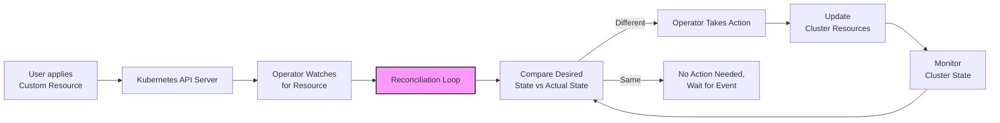

# Kubernetes Operator Tutorial with Kubebuilder

## Goal

This tutorial provides a **30-minute introduction** to writing Kubernetes operators using Kubebuilder. By the end of this tutorial, you will understand:

- What Kubernetes operators are and how they work
- How to create a Custom Resource Definition (CRD) using Kubebuilder
- How to implement the reconciliation logic for your operator
- How to build, deploy, and test your operator

## What is a Kubernetes Operator?

A Kubernetes operator is a method of packaging, deploying, and managing a Kubernetes application. An operator follows the **"reconcile loop"** pattern:

> **"An operator attempts to reconcile the declared state of our CRD (API in Kubebuilder terms) or die trying!"**

### How Operators Work

1. **Custom Resource Definition (CRD)**: Defines a new custom resource type for your application
2. **Custom Resource (CR)**: Instances of your custom resource that users create
3. **Controller**: Watches for changes to your custom resources and attempts to reconcile the actual state with the desired state
4. **Reconciliation Loop**: Continuously monitors and adjusts the cluster to match the declared state

The operator pattern extends Kubernetes to manage complex applications by encoding operational knowledge into software.

## Operator Example Worflow Diagram

## Prerequisites

Before starting this tutorial, ensure you have the following tools installed:

### Required Tools

#### 1. Go (Golang)
- **Version**: 1.21 or later
- **Installation**:
  ```bash
  # Ubuntu/Debian
  sudo apt update
  sudo apt install golang-go
  
  # macOS (using Homebrew)
  brew install go
  
  # Verify installation
  go version
  ```

#### 2. Kubebuilder
- **Version**: 4.7.0 (latest stable)
- **Note**: For new projects, you must use the v4 plugin and project version.
- **Installation**:
  ```bash
  # Download and install kubebuilder
  curl -L -o kubebuilder https://go.kubebuilder.io/dl/latest/$(go env GOOS)/$(go env GOARCH)
  chmod +x kubebuilder && sudo mv kubebuilder /usr/local/bin/
  
  # Verify installation
  kubebuilder version
  ```

#### 3. Docker (or other OCI-compatible container runtime)
Choose one of the following:

**Docker**:
```bash
# Ubuntu/Debian
sudo apt update
sudo apt install docker.io
sudo systemctl start docker
sudo usermod -aG docker $USER

# macOS
brew install --cask docker
```

**Buildah** (Docker alternative):
```bash
# Ubuntu/Debian
sudo apt install buildah

# macOS
brew install buildah
```

**Nerdctl** (Docker-compatible CLI for containerd):
```bash
# Download and install nerdctl
wget https://github.com/containerd/nerdctl/releases/download/v1.7.5/nerdctl-1.7.5-linux-amd64.tar.gz
tar -xzf nerdctl-1.7.5-linux-amd64.tar.gz
sudo mv nerdctl /usr/local/bin/
```

#### 4. Kubernetes Cluster
You'll need access to a Kubernetes cluster for testing:

**Minikube** (for local development):
```bash
# Install minikube
curl -LO https://storage.googleapis.com/minikube/releases/latest/minikube-linux-amd64
sudo install minikube-linux-amd64 /usr/local/bin/minikube

# Start cluster
minikube start
```

**Kind** (alternative local cluster):
```bash
# Install kind
curl -Lo ./kind https://kind.sigs.k8s.io/dl/v0.20.0/kind-linux-amd64
chmod +x ./kind
sudo mv ./kind /usr/local/bin/

# Create cluster
kind create cluster
```

#### 5. kubectl
```bash
# Ubuntu/Debian
sudo apt install kubectl

# macOS
brew install kubectl

# Verify installation
kubectl version --client
```

## Project Structure

After running the Kubebuilder commands, your project will have the following structure:

```
my-operator/
├── api/                    # API definitions (CRDs)
│   └── v1alpha1/         # API version
│       ├── groupversion_info.go
│       ├── myresource_types.go
│       └── zz_generated.deepcopy.go
├── config/                # Kubernetes manifests
│   ├── crd/              # CRD manifests
│   ├── rbac/             # RBAC manifests
│   ├── manager/          # Manager deployment
│   └── webhook/          # Webhook manifests
├── controllers/           # Controller implementations
│   └── myresource_controller.go
├── hack/                  # Build scripts
├── main.go               # Operator entry point
├── Dockerfile            # Container image
├── Makefile              # Build targets
├── go.mod                # Go modules
└── go.sum                # Go modules checksums
```

## Quick Start Commands

### 1. Initialize the Project
```bash
# Create a new operator project (Kubebuilder v4.x)
kubebuilder init --plugins go/v4 --project-version=4 --domain example.com --repo example.com/my-operator

# Navigate to the project directory
cd my-operator
```

### 2. Add API (Custom Resource)
```bash
# Create a new API with Group, Version, Kind (GVK)
kubebuilder create api --group mygroup --version v1alpha1 --kind MyResource

# This will prompt you to:
# - Create Resource [y/n]: y
# - Create Controller [y/n]: y
```

### 3. Build and Deploy
```bash
# Generate manifests
make manifests

# Build the operator
make build

# Deploy to cluster
make deploy

# Install CRDs
make install
```

### 4. Test Your Operator
```bash
# Create a custom resource instance
kubectl apply -f config/samples/

# Check the status
kubectl get myresources
kubectl describe myresource myresource-sample
```

## Key Concepts

### Group Version Kind (GVK)
- **Group**: Logical collection of APIs (e.g., `mygroup.example.com`)
- **Version**: API version for evolution (e.g., `v1alpha1`, `v1beta1`, `v1`)
- **Kind**: The resource type name (e.g., `MyResource`)

### Reconciliation
The core of any operator is the reconciliation loop:
```go
func (r *MyResourceReconciler) Reconcile(ctx context.Context, req ctrl.Request) (ctrl.Result, error) {
    // 1. Fetch the MyResource instance
    // 2. Check if the desired state matches actual state
    // 3. Take actions to reconcile differences
    // 4. Return result (requeue if needed)
}
```

## Useful Commands

```bash
# Generate code after API changes
make generate

# Run tests
make test

# Run locally (for development)
make run

# Build and push container image
make docker-build docker-push

# Clean up
make uninstall
make undeploy
```

## References and Documentation

### Official Documentation
- **[Kubebuilder Book](https://book.kubebuilder.io/)**: Comprehensive guide to building operators
- **[Operator SDK Documentation](https://sdk.operatorframework.io/)**: Alternative framework for building operators
- **[Kubernetes SIG API Machinery](https://github.com/kubernetes/community/tree/master/sig-api-machinery)**: API machinery working group
- **[Kubernetes Custom Resources](https://kubernetes.io/docs/concepts/extend-kubernetes/api-extension/custom-resources/)**: Official documentation on CRDs

### Community Resources
- **[Operator Pattern](https://kubernetes.io/docs/concepts/extend-kubernetes/operator/)**: Kubernetes documentation on operators
- **[Kubernetes SIG Architecture](https://github.com/kubernetes/community/tree/master/sig-architecture)**: Architecture working group
- **[CNCF Operator Framework](https://operatorframework.io/)**: Operator lifecycle management

### Best Practices
- **[Operator Best Practices](https://sdk.operatorframework.io/docs/best-practices/)**: Guidelines for building production operators
- **[Kubernetes API Conventions](https://github.com/kubernetes/community/blob/master/contributors/devel/sig-architecture/api-conventions.md)**: API design guidelines

## Next Steps

After completing this tutorial, explore:
1. **Webhooks**: Add validation and defaulting logic
2. **Metrics**: Expose Prometheus metrics
3. **Leader Election**: Handle multiple operator instances
4. **Finalizers**: Clean up resources when CR is deleted
5. **Status Conditions**: Report resource status
6. **Events**: Emit Kubernetes events for debugging

---

**Happy Operator Building! 🚀** 
